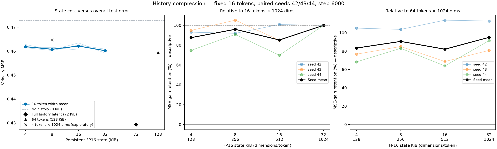

# DINO-Video-Experiment


研究问题：给定相邻的真实视频块 A、B，用从 A 提取的 K 个 D 维向量替代完整的 A 块 VAE latent 作为历史条件时，B 的 flow-matching 速度预测误差如何变化？

当前使用 UCF101 六类的相邻视频块 A、B，以冻结 Wan2.1 VAE 得到 latent，训练轻量历史编码器与 3D U-Net 预测 B 的 flow-matching 速度。
当前较好的成本—误差折中是 **16×256、FP16 8 KiB**：三个种子上，平均保留原 64×1024 任务驱动基准约 **90.7%** 的去噪收益，保留上轮 16×1024 基准约 **96.0%** 的收益。这里的保留比率针对的是MSE，并不是携带了多少信息。（token_num*dim)

视频和 latent 按时间切成相邻块（chunks）；这里的语义表示不是分割标签，不使用分割网络或 mask。视频块 A／B 表示先后时段，与实验 00 的旧组键 A／B 不同。

## 组名对照

| 中文组名 | 英文图名 | 实验与旧键 |
|---|---|---|
| 无历史 | No history | 01–04B：`N` |
| 教师语义 | Teacher semantics | 01：`S`（Semantics） |
| 教师语义＋dropout | Teacher + dropout | 01：`SD`；02：`T`，同一基线 |
| 完整历史 latent | Full history latent | 00：`A`；01、04：`L` |
| 完整历史＋预测语义 | Latent + prediction | 00：`B` |
| 直接替换 | Direct swap | 02：`D` |
| 预测条件训练 | Train on predictions | 02：`P` |
| 仅去噪监督 | FM only | 03：`C`；04 的 64-token 基准 |
| 去噪＋语义对齐 | FM + alignment | 03：`J` |

## 实验进展

| 实验 | 问题 | 种子数 | 主要结果与入口 |
|---|---|---:|---|
| 00 · 初始 A/B | 已有完整历史 latent 时，预测语义能否额外帮助？ | 1 | 验证误差下降 0.90%；[初始记录](experiments/00_initial_ab/README.md) |
| 01 · 历史语义 | 不给历史 latent，只给教师语义是否有效？ | 3 | 加 10% 条件 dropout 后，测试误差相对无历史组下降 2.39%；[实验](experiments/01_history_semantics/README.md) |
| 02 · 预测语义 | 预测表示能保留多少教师收益？ | 3 | 直接替换保留 85.5%；适配训练后相对无历史组改善 2.90%；[实验](experiments/02_predicted_semantics/README.md) |
| 03 · 语义监督 | 同容量编码器是否需要额外 V-JEPA 对齐？ | 10 | 去噪＋语义对齐相对仅去噪监督的测试改善均值 +0.29%，训练种子均值区间跨零，未显示稳定优势；[实验](experiments/03_semantic_supervision/README.md) |
| 04 · token 压缩 | 仅用去噪监督，状态能压到多小？ | 3 | 128→32 KiB，平均保留 95.1% 的原基准收益；[实验](experiments/04_history_compression/README.md) |
| 04B · 维度压缩 | 固定 16 个 token，继续缩小维度 | 3 | 32→8 KiB，保留局部基准 96.0%、原基准 90.7% 的收益；[实验](experiments/04_history_compression/width_sweep/README.md) |
| 05 · 边界与表示 | 仅压缩表示、仅边界 latent、两者结合，哪种更有效？ | 3 | 26 KiB 组合比等预算纯表示改善 12.87%，比仅边界改善 1.48%；[实验](experiments/05_boundary_state/README.md) |

## 当前压缩结果

下表统一使用种子 **42、43、44**，K64 仅取第三问仅去噪监督组的这三个种子，不混入第三问的十种子均值。每组训练 6,000 步；测试固定五档噪声时间、每窗口四份噪声，按窗口→视频→来源组→类别宏平均。

| 历史条件 | FP16 状态 | 测试 MSE ↓ | 原 K64 去噪收益保留率 |
|---|---:|---:|---:|
| 无历史 | 0 KiB | 0.472932 | — |
| K64 · 64×1024 | 128 KiB | 0.459365 | 100.0% |
| K16 · 16×1024 | 32 KiB | 0.460189 | 95.1% |
| **16×256** | **8 KiB** | **0.460773** | **90.7%** |
| 16×128 | 4 KiB | 0.461860 | 83.4% |
| 完整历史 latent | 72 KiB | 0.429315 | — |

状态大小不含模型权重和训练激活。收益保留率先逐种子计算再平均；完整历史 latent 仍有更低的去噪误差。逐种子结果和区间见各实验 README。



## Installation

实测环境：Linux、Python 3.12.3、PyTorch 2.8.0 + CUDA 12.8

```bash
git clone https://github.com/johnmayer123-bluser/DINO-Video-Experiment.git
cd DINO-Video-Experiment

# 普通用户请在 apt-get 前加 sudo。
apt-get update
apt-get install -y git curl unzip unrar

# 已有实验环境时可直接使用现有 Python。
python -m pip install torch==2.8.0 torchvision==0.23.0 \
  --index-url https://download.pytorch.org/whl/cu128
python -m pip install -r requirements.txt
```

## Download Models & Dataset

```bash
# 在仓库根目录执行；支持续传，已有的完整资源会跳过。
bash scripts/download_assets.sh
```

| 资源 | 下载内容与来源 | 本地位置 |
|---|---|---|
| Wan2.1 VAE | [Wan-AI 官方 Diffusers 权重](https://huggingface.co/Wan-AI/Wan2.1-T2V-1.3B-Diffusers/tree/main/vae)，只取 VAE 配置和权重，约 508 MB | `models/wan-vae/` |
| V-JEPA ViT-L/16 | [Meta 官方模型](https://github.com/facebookresearch/jepa#model-zoo)，使用 `target_encoder`，约 5.14 GB | `models/vjepa/vitl16.pth.tar` |
| V-JEPA 代码 | [facebookresearch/jepa](https://github.com/facebookresearch/jepa)，固定本次实验的 commit | `third_party/jepa/` |
| UCF101 | [官方数据与划分](https://www.crcv.ucf.edu/research/data-sets/ucf101/)，整包约 6.93 GB，仅解压下面六类 | `data/UCF-101/`、`data/ucfTrainTestlist/` |


六类为 `BasketballDunk`、`GolfSwing`、`LongJump`、`TennisSwing`、`VolleyballSpiking`、`Diving`。官方 UCF101 提供完整 RAR，脚本先下载整包，再选择性解压六类。
确认视频已解压后，可释放压缩包占用：

```bash
rm data/UCF101.rar
```

Wan2.1 仅用于 VAE 编解码，实验中的轻量去噪器从头训练。

## Data & Preprocessing

使用 UCF101 官方 split 1；从官方训练集按“类别＋来源组”留出约 20% 作为验证集，固定划分种子 42。同组视频及其窗口不会跨集合。

| 划分 | 原视频数 | 33 帧窗口数 |
|---|---:|---:|
| Train | 415 | 1,624 |
| Validation | 120 | 475 |
| Test | 196 | 759 |

六类原有 833 个视频，102 个视频在 12 fps 下不足 33 帧，最终获得 2,858 个窗口。每个视频最多取 4 个起点。

- 统一采样为 12 fps，每窗口 33 帧：第 0 帧作为 VAE 起始帧；A 为 1–16 帧，B 为 17–32 帧。
- 两路编码采用相同的中心正方形视野。VAE 输入 192×192；V-JEPA 输入 224×224，并使用 ImageNet 通道归一化。
- VAE 连续编码整段，使用后验均值以及权重规定的 latent 标准化。缓存形状为 `[16,9,24,24]`，A 取 `[:,1:5]`，B 取 `[:,5:9]`。
- V-JEPA 对 A、B **分别前向**，单块时空 token 池化到 `[4,4,4,1024]`。历史条件仅来自 A。

```bash
mkdir -p logs
python -u scripts/prepare_cache.py --root . --stage all
```

缓存写入 `cache/ucf6_12fps_192/`，包括划分清单、预处理元数据及逐窗口张量。重复执行会跳过已有缓存。

## 复现与结果

训练、评估命令及依赖顺序见各实验 README。训练输出放在 `runs/`，仓库附带原始误差、统计与图表，不分发训练检查点。无需 GPU，可重算附带结果并绘图：

```bash
python experiments/01_history_semantics/plot_results.py
python experiments/02_predicted_semantics/analyze.py
python experiments/03_semantic_supervision/analyze.py
python experiments/04_history_compression/analyze.py
python experiments/04_history_compression/width_sweep/analyze.py
```

## Repository Structure

```text
DINO-Video-Experiment/
├── experiments/
│   ├── 00_initial_ab/             # 初始 A/B 方法、命令与结果入口
│   ├── 01_history_semantics/      # 教师语义与无历史对照
│   ├── 02_predicted_semantics/    # 直接替换与预测条件训练
│   ├── 03_semantic_supervision/   # 十种子仅去噪／加语义对齐同容量对照
│   └── 04_history_compression/    # token 压缩与 width_sweep/
├── scripts/                      # 公共下载、缓存、模型与初始 A/B 代码
├── assets/                       # 初始实验图
├── results/                      # 初始实验结果；后续结果随各实验目录保存
└── requirements.txt
```
