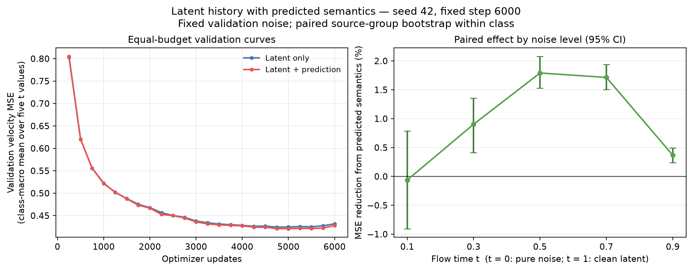

# 00 · 初始 A/B 实验

[返回仓库首页](../../README.md)

本页保留初始 A/B 阶段的方法、训练与验证结果；以下命令均在仓库根目录执行。

**Frozen V-JEPA semantics for next-chunk video denoising**

受 [DINO Forcing](https://arxiv.org/abs/2610.11751) 的语义预测与自条件思路启发，本仓库记录一个视频生成的初步实验：**当模型已经能看到上一视频块的完整 latent 时，额外提供该块的预测语义，能否改善下一块去噪？**

在 UCF101 六类、单个训练种子的验证集上，加入预测语义使平均速度预测 MSE 从 **0.431757** 降至 **0.427852**，相对下降 **0.904%**。这是一个相邻块去噪实验，尚未实现完整的 two-pass 生成器，也没有验证只用语义替代历史。

## Idea & Method

取连续视频块 A、B，使用冻结的 Wan2.1 causal VAE 得到 $z_A$、$z_B$。冻结的原版 V-JEPA ViT-L/16 单独编码干净的 A，产生时空教师特征$\phi(A)$。

1. **预测历史语义。** 训练一个 139.8 万参数的 3D 卷积预测头 $q(z_A)$，逐位置对齐 $\phi(A)$，损失为 $1 - cosine$。教师只看到 A，不读取未来 B。预测头训练结束后冻结。
2. **成对训练去噪器。** 两组使用相同的 3D U-Net、初始化、训练窗口、噪声和时间步。每组约 1,343 万参数，空间通道为 64/128/256，在瓶颈处通过交叉注意力读取 64 个语义 token。

| 实验组 | 历史条件 | 语义条件 |
|---|---|---|
| A · Latent only | 完整的 `z_A` | 全零 token，保留相同网络结构 |
| B · + Predicted semantics | 完整的 `z_A` | 冻结预测头输出 `q(z_A)`，逐 token L2 归一化 |

对下一块进行 flow matching，约定 `t=0` 为纯噪声、`t=1` 为干净 latent：

$$
z_{B,t}=(1-t)\epsilon+t z_B,\qquad v^\star=z_B-\epsilon,\qquad
\mathcal L=\mathbb E\left[\|v_\theta(z_{B,t},t,z_A,h)-v^\star\|_2^2\right].
$$

**这个实验想要验证的是：预训练语义监督能否让生成器更容易利用这段历史。**

## 数据与环境

公共安装、模型与数据下载见[仓库首页](../../README.md#installation)，数据划分和缓存步骤见[数据预处理](../../README.md#data--preprocessing)。本轮只评估验证集。

## Training

以语义头先训练 1,000 步，再恢复到 3,000 步；A/B 去噪器先各训练 3,000 步，再同时恢复到 6,000 步。

```bash
# 1. 训练语义预测头：q(z_A) -> phi(A)
python -u scripts/train_semantic_head.py --root . \
  --steps 1000 --batch-size 16 --seed 42
python -u scripts/train_semantic_head.py --root . \
  --steps 3000 --batch-size 16 --seed 42 --resume

# 2. 冻结预测头，成对训练 A/B 去噪器
python -u scripts/train_denoiser_ab.py --root . \
  --steps 3000 --batch-size 16 --seed 42
python -u scripts/train_denoiser_ab.py --root . \
  --steps 6000 --batch-size 16 --seed 42 --resume

# 3. 绘制本次运行结果
python scripts/plot_denoiser_ab.py runs/denoiser_ab_seed42 --step 6000
```

预测头和去噪器均使用 AdamW，学习率 `2e-4`、batch 16、BF16。语义头按验证集中心化正负样本相似度差选点，本次最佳为第 2,800 步。A/B 主比较固定使用两组第 6,000 步权重；第 2,000→3,000 步两组验证误差仍各下降超过 2%，因此按既定规则同时续训。

| 输出 | 路径 |
|---|---|
| 冻结语义预测头 | `runs/semantic_head_seed42/best.pt` |
| A/B 两组最终参数 | `runs/denoiser_ab_seed42/weights_step06000.pt`，字典键为 `models.A`、`models.B` |
| A/B 断点（含优化器和随机流） | `runs/denoiser_ab_seed42/last.pt` |
| 逐窗口误差与最终统计 | `runs/denoiser_ab_seed42/errors_step06000.npz`、`summary_step06000.json` |

SSH 断开后仍需运行时，可用 `nohup` 启动某一训练阶段，例如：

```bash
nohup python -u scripts/train_denoiser_ab.py --root . \
  --steps 3000 --batch-size 16 --seed 42 \
  > logs/denoiser_ab.log 2>&1 < /dev/null &
tail -f logs/denoiser_ab.log
```

已有检查点时使用 `--resume`。只评估服务器上的最终 A/B 检查点：

```bash
python -u scripts/train_denoiser_ab.py --root . --eval-only
```

仓库提供指标与误差数据，不分发训练检查点。无需 GPU 或模型即可重画已公开的结果图：

```bash
python scripts/plot_denoiser_ab.py results/denoiser_ab_seed42 --step 6000
```

## Results

### Semantic predictor

| 验证指标 | 结果 |
|---|---:|
| 与教师的逐 token cosine | 0.83885 |
| 固定输出训练均值的 cosine 基线 | 0.71430 |
| 同类视频 9 选 1 检索准确率 | 87.84% |
| 随机检索准确率 | 11.11% |

检索负例来自同类别、不同来源组的 8 个视频；先逐 token 归一化，再减训练集均值。详见 [预测头结果](../../results/semantic_head_seed42/best_metrics.json)。

### Next-chunk denoising



验证固定五档 `t` 与每个窗口的一份高斯噪声。先平均窗口，再按原视频、来源组和类别逐级宏平均。95% 区间通过类别内来源组配对 bootstrap（5,000 次）计算，共 24 个验证来源组。

| t（0=纯噪声，1=干净） | A：latent only ↓ | B：+ semantics ↓ | MSE 相对下降 |
|---|---:|---:|---:|
| 0.1 | 0.228637 | 0.228781 | −0.063% |
| 0.3 | 0.263176 | 0.260799 | 0.903% |
| 0.5 | 0.331763 | 0.325822 | 1.791% |
| 0.7 | 0.478778 | 0.470572 | 1.714% |
| 0.9 | 0.856430 | 0.853288 | 0.367% |
| **五档平均** | **0.431757** | **0.427852** | **0.904%** |

固定 B 的最终权重，只干预语义条件：

| 干预 | 窗口数 | 正确语义相对该干预的 MSE 改善 |
|---|---:|---:|
| 语义置零 | 475 | 1.128% |
| 换成同类、不同来源组视频的语义 | 475 | 1.127% |
| 换成同视频较早且不重叠片段的语义 | 156 | 0.285% |

完整的分组统计、区间及条件干预见 [最终统计](../../results/denoiser_ab_seed42/summary_step06000.json)。[逐窗口误差](../../results/denoiser_ab_seed42/errors_step06000.npz) 可与同目录的 `validation_manifest.json` 按 ID 对齐，复核来源组统计。

### Scope

本轮结果说明了什么：在真实完整历史 latent 已存在时，预测语义对下一块速度预测提供了小幅帮助。收益主要出现在 `t=0.5、0.7`，`t=0.1` 尚无明确收益。

## 对应文件

[语义预测头](../../scripts/train_semantic_head.py) · [A/B 训练与评估](../../scripts/train_denoiser_ab.py) · [结果绘图](../../scripts/plot_denoiser_ab.py)。原始指标和图像仍位于仓库根目录的 `results/` 与 `assets/`，无需移动。
