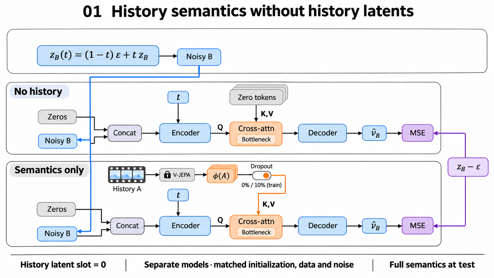
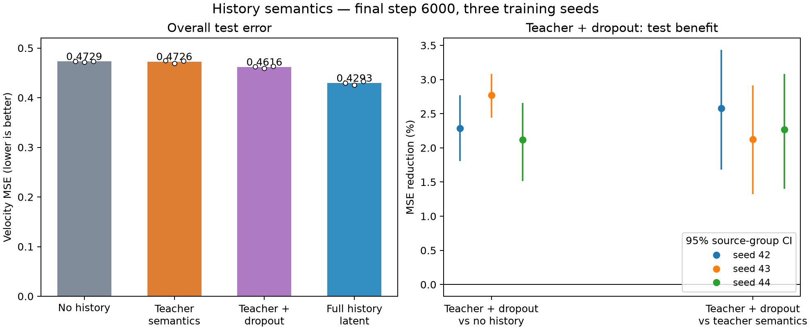

# 01 · 历史语义能否独立指导下一块去噪？

[返回仓库首页](../../README.md)

**结果：仅使用上一块的真实语义，并在训练时加入 10% 条件 dropout，测试集去噪误差相对无历史基线平均下降 2.39%。** 一共是做了3个seed，结果都是正向结果。

## 探究问题

我们的目标是，只用语义状态表达视频历史，在这之前，探究最基础的问题：
**不提供上一视频块的 latent，只提供该块的语义表示，是否有助于下一块去噪？**

取相邻视频块 A、B，用冻结的 Wan2.1 causal VAE 得到 latent；冻结的 V-JEPA ViT-L/16 单独编码 A，得到 64×1024 的语义特征 $\phi(A)$。去噪器接收含噪的 B，根据不同实验组读取历史条件，预测去噪速度。



图中各组都把历史 latent 输入位置填零，与同一含噪 B 沿通道拼接后送入 3D U-Net。无历史组在交叉注意力中读取零 token；仅语义组直接读取冻结 V-JEPA 对 A 提取的表示，视频特征提供 Query，语义提供 Key、Value。仅语义路径分别训练 0% 和 10% dropout 两个版本，测试时均提供完整语义；各模型独立训练，以相同目标速度比较 MSE。瓶颈是 U-Net 空间尺寸最小的中间层。

## 实验设计

| 组别 | 旧组键 | 历史 latent | 历史语义 | 训练时语义 dropout |
|---|---|---|---|---|
| 无历史 | `N` | 无 | 无 | — |
| 教师语义 | `S`（Semantics） | 无 | $\phi(A)$ | 0% |
| 教师语义＋dropout | `SD`（Semantics + Dropout；第二问记作 `T`） | 无 | $\phi(A)$ | 10% |
| 完整历史 latent | `L` | $z_A$ | 无 | — |

视频与 latent 按时间切块（chunks）；Semantics 指语义表示，不是分割标签，不使用分割网络或 mask。

四组使用相同的 3D U-Net，每组约 1,343 万参数。语义通过瓶颈处的交叉注意力注入；同一训练种子下，各组共享初始化、样本、时间步和噪声。教师语义＋dropout 组在训练时随机将约十分之一的样本语义置零，测试时正常提供语义。

训练目标为 flow matching：

$$
z_{B,t}=(1-t)\epsilon+t z_B,\qquad
v^\star=z_B-\epsilon,\qquad
\mathcal L=\mathbb E\|v_\theta-v^\star\|_2^2.
$$

| 设置 | 数值 |
|---|---|
| 数据 | UCF101 六类，与初始 A/B 实验使用相同缓存 |
| 训练／验证／测试窗口 | 1,624／475／759 |
| 视频块 | 12 fps；A、B 各 16 帧，另有 1 帧 VAE 起始帧 |
| 随机种子 | 42、43、44 |
| 每组训练 | 6,000 步，batch 16，BF16 |
| 优化器 | AdamW，学习率 2e-4，weight decay 0.01 |
| 评估 | 最终权重；五档 t=0.1、0.3、0.5、0.7、0.9；每窗口四份固定噪声 |

MSE 按窗口、视频、来源组、类别逐级平均。表中的改善率先在每个训练种子内计算，再取三个种子的平均；95% 区间通过来源组配对 bootstrap 计算。

## 实验过程

先完成无历史、教师语义、完整历史 latent 三组对照：未加 dropout 的教师语义组测试收益接近零。随后在验证集比较语义接入方式，选用简单的 10% 条件 dropout；最后固定三个教师语义＋dropout 模型，在同一测试集上补充评估，并与其余三组对照。

## 运行

安装与模型、数据下载见[仓库首页](../../README.md)。以下命令均在仓库根目录执行。

```bash
# 1. 提取缓存；已有缓存可跳过
python scripts/prepare_cache.py --root . --stage all

# 2. 训练无历史／教师语义／教师语义＋dropout／完整历史 latent 四组
for seed in 42 43 44; do
  python experiments/01_history_semantics/train.py --seed "$seed" --steps 6000
done

# 3. 评估最终权重
python experiments/01_history_semantics/evaluate.py --split test --seeds 42 43 44

# 4. 汇总本次运行并绘图
python experiments/01_history_semantics/plot_results.py --run-root runs
```

训练输出放在 `runs/history_semantics_seed{seed}/`。中断后使用相同训练命令并添加 `--resume`；验证集评估将 `--split test` 改为 `--split val`。

无需训练或 GPU，也可以直接重画仓库附带的结果：

```bash
python experiments/01_history_semantics/plot_results.py
```

## 实验结果

| 组别 | 测试 MSE ↓ | 相对无历史的误差下降 ↑ |
|---|---:|---:|
| 无历史 | 0.472932 | — |
| 教师语义 | 0.472607 | 0.07% |
| **教师语义＋10% dropout** | **0.461619** | **2.39%** |
| 完整历史 latent | 0.429315 | 9.22% |

教师语义＋dropout 相对未加 dropout 的教师语义组，测试误差平均下降 **2.32%**。下面给出教师语义＋dropout 相对无历史的逐种子结果：

| 随机种子 | 误差下降 | 95% 区间 |
|---|---:|---|
| 42 | 2.29% | [1.81%, 2.77%] |
| 43 | 2.77% | [2.44%, 3.08%] |
| 44 | 2.12% | [1.52%, 2.66%] |



**结论：历史语义可以帮助下一块去噪，10% 条件 dropout 让这一帮助在三个种子上稳定出现。后续实验采用教师语义＋dropout 作为语义接入基线（第二问旧键为 `T`，与本问 `SD` 相同）。**

## 文件

```text
01_history_semantics/
├── README.md          # 问题、方案、命令与结果
├── train.py           # 四组配对训练
├── evaluate.py        # 验证集／测试集评估
├── common.py          # 缓存读取与评估前向
├── metrics.py         # 分组统计
├── plot_results.py    # 重算汇总并绘图
└── results/           # 三个种子的原始误差、汇总和结果图
```

公共模型与数据处理代码复用仓库的 `scripts/`。结果数值见 [summary.json](results/summary.json)，图表由本目录的逐窗口误差生成。
