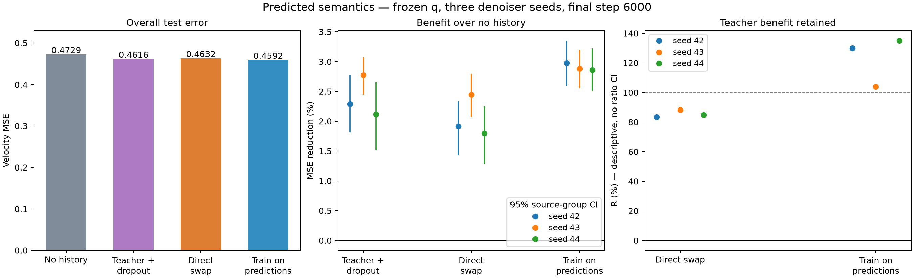

# 02 · 预测语义能保留多少教师收益？

[返回仓库首页](../../README.md) · [第一问：历史语义](../01_history_semantics/README.md)

**结果：直接替换平均保留 85.49% 的教师去噪收益；用预测条件从头训练后，相对无历史组的测试误差下降 2.90%，教师收益保留率达到 122.95%。**

## 探究问题

第一问中，教师语义加 10% 条件 dropout 使测试去噪误差相对无历史组下降 2.39%。现在把教师表示 $\phi(A)$ 换成已有预测器的输出 $q(z_A)$，观察下一块 B 的去噪效果，以及能保留多少教师语义的帮助。


直接替换仅更换测试条件；预测条件训练从头训练去噪器，预测器始终冻结。

## 实验设计

所有组的去噪器都不直接接收历史 latent。预测器只读取上一块 A 的 latent，输出 64×1024 的语义 token，逐 token L2 归一化后作为条件。

| 组别 | 旧组键 | 去噪器训练时的条件 | 测试时的条件 | 本轮操作 |
|---|---|---|---|---|
| 无历史 | `N` | 无 | 无 | 复用第一问的无历史组 |
| 教师语义＋dropout | `T`（第一问的 `SD`，同一基线） | $\phi(A)$＋10% dropout | $\phi(A)$ | 复用第一问的权重 |
| 直接替换 | `D` | 与教师语义＋dropout 相同 | $q(z_A)$ | 固定教师条件去噪器权重，只替换条件 |
| 预测条件训练 | `P` | $q(z_A)$＋10% dropout | $q(z_A)$ | 从相同随机初始化重新训练 |

冻结复用初始实验中的 3D 卷积预测器 `runs/semantic_head_seed42/best.pt`，对应第 2,800 步。三个去噪器种子共用同一个预测器，不更新预测器参数。

数据和训练设置沿用第一问：UCF101 六类，训练／验证／测试为 1,624／475／759 个窗口；去噪器种子 42、43、44；每组 6,000 步，batch 16，AdamW 学习率 2e-4，BF16。预测条件训练组的初始化、训练样本、时间步、噪声和 dropout 随机流与对应的教师语义＋dropout 组配对。

最终评估使用五档 t 和每窗口四份固定噪声。主要看整体速度 MSE，以及相对无历史的误差下降。教师收益保留率定义为：

$$
R_X=\frac{\mathrm{MSE}_N-\mathrm{MSE}_X}{\mathrm{MSE}_N-\mathrm{MSE}_T}\times100\%,\qquad X\in\{D,P\}.
$$

公式下标沿用上表旧组键。100% 表示保留全部教师收益，0% 表示回到无历史水平，负数表示比无历史组更差。先按种子计算，再取平均。

## 实验过程

先评估直接替换组，观察教师去噪器对预测表示的适应情况；随后从头训练预测条件组，判断预测表示经过适配后是否能作为有效条件。全部使用固定的最终权重，不调整预测器或注入方式。

## 运行

在仓库根目录执行，复用已有缓存、预测器和第一问的权重：

```bash
# 直接替换：无历史／教师语义＋dropout／直接替换
python experiments/02_predicted_semantics/evaluate.py --split test --seeds 42 43 44 --direct-only

# 预测条件训练：冻结预测器，从头训练去噪器
for seed in 42 43 44; do
  python experiments/02_predicted_semantics/train.py --seed "$seed" --steps 6000
done

# 最终对照：无历史／教师语义＋dropout／直接替换／预测条件训练
python experiments/02_predicted_semantics/evaluate.py --split test --seeds 42 43 44

# 从本次运行汇总结果
python experiments/02_predicted_semantics/analyze.py --run-root runs --split test
```

新权重与评估文件保存到 `runs/predicted_semantics_seed{seed}/`；中断后训练命令添加 `--resume`。

无需训练或 GPU，可直接从仓库附带的结果重画图表：

```bash
python experiments/02_predicted_semantics/analyze.py
```

## 实验结果

下表为三个去噪器种子的测试均值，全部使用同一个冻结预测器。

| 组别 | 测试 MSE ↓ | 相对无历史的误差下降 ↑ | 教师收益保留率 |
|---|---:|---:|---:|
| 无历史 | 0.472932 | — | 0% |
| 教师语义＋dropout | 0.461619 | 2.39% | 100% |
| 直接替换 | 0.463238 | 2.05% | 85.49% |
| **预测条件训练** | **0.459197** | **2.90%** | **122.95%** |

| 随机种子 | 直接替换相对无历史改善 | 预测条件训练相对无历史改善 | 直接替换保留率 | 预测条件训练保留率 |
|---|---:|---:|---:|---:|
| 42 | 1.91% | 2.97% | 83.49% | 129.94% |
| 43 | 2.45% | 2.88% | 88.21% | 103.94% |
| 44 | 1.79% | 2.86% | 84.76% | 134.98% |

直接替换和预测条件训练相对无历史的改善，在三个种子的来源组配对 95% 区间中都高于零。预测条件训练相对直接替换再降低 **0.87%** 的误差，三个种子的区间也都高于零。

预测条件训练相对教师语义＋dropout 平均降低 **0.52%** 的误差，其中 seed 43 的区间包含零；因此当前结果支持预测条件有效、匹配训练进一步改善，尚不能说稳定超越教师。保留率超过 100% 指该任务的 MSE 收益超过教师参考。

验证集上，直接替换、预测条件训练相对无历史的误差分别下降 1.90%、2.79%。预测表示与教师表示的测试逐 token cosine 为 0.821。



**结论：已有预测器产生的表示能够指导下一块去噪，直接替换就能保留大部分教师收益；用预测条件训练去噪器后，效果进一步改善。**

## 文件

```text
02_predicted_semantics/
├── README.md       # 问题、设计、命令与结果
├── conditions.py   # 冻结预测器与条件评估
├── train.py        # 预测条件组的训练
├── evaluate.py     # 直接替换及四组最终评估
├── analyze.py      # 汇总、收益保留率与绘图
└── results/        # 三个种子的原始误差、汇总和结果图
```

详细数值见 [summary.csv](results/summary.csv) 和 [summary.json](results/summary.json)，训练过程见 [training.json](results/training.json)。数据读取、模型和分组统计复用第一问及公共 `scripts/`。
