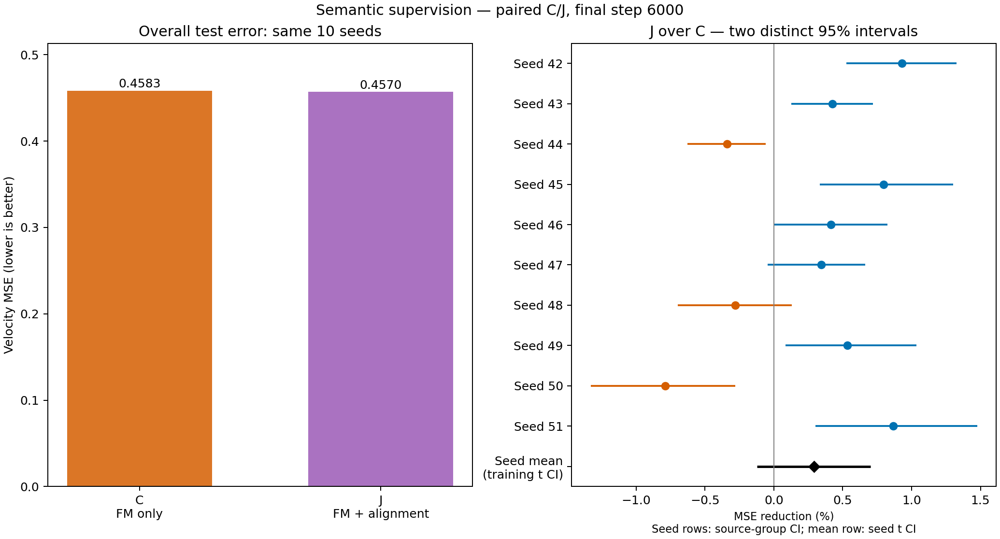

# 03 · V-JEPA 语义监督是否带来额外收益？

[返回仓库首页](../../README.md) · [第二问：预测语义](../02_predicted_semantics/README.md)

**结果：十个训练种子中，加入 V-JEPA 对齐平均降低 0.29% 的测试误差，7 个种子改善、3 个退化；跨种子的 95% 均值区间为 [−0.12%, +0.70%]，尚未显示稳定的额外优势。**

## 探究问题

前两问已经发现历史表示能够帮助下一块去噪。本轮进一步比较：**相同容量的历史编码器，只接受下一块去噪监督，是否已经足够；加入 V-JEPA 语义对齐能否进一步改善效果？**

## 实验设计

两组都用相同的 3D 编码器读取上一块 A 的 latent，输出 64×1024 的表示。表示逐 token 归一化后，通过交叉注意力指导 B 去噪；去噪器不直接接收 A 的 latent。

| 组别 | 历史编码器 | 编码器与去噪器的训练目标 |
|---|---|---|
| C · 任务驱动编码 | 从随机初始化开始训练 | 下一块去噪损失 |
| J · 加入语义监督 | 与 C 使用相同初始化 | 去噪损失＋V-JEPA 对齐损失 |

$$
\mathcal L_C=\mathcal L_{\mathrm{FM}},\qquad
\mathcal L_J=\mathcal L_{\mathrm{FM}}+\lambda\mathcal L_{\mathrm{Align}},\qquad\lambda=1.
$$

对齐损失为每个 token 与对应 $\phi(A)$ 的 $1-\mathrm{cosine}$ 的平均值。两组的去噪梯度都能回传到历史编码器；J 额外接受冻结 V-JEPA 提供的监督。本轮固定对齐权重为 1。

两组均从头训练，不加载第二问的预训练预测器。相同种子下，初始化、训练样本、时间步、噪声和条件 dropout 掩码全部配对。

| 设置 | 数值 |
|---|---|
| 数据 | 相同的 UCF101 六类缓存 |
| 训练／验证／测试窗口 | 1,624／475／759 |
| 历史编码器 | 与已有 SemanticHead 相同的 3D 卷积结构，约 140 万参数 |
| 去噪器 | 相同的 3D U-Net，约 1,343 万参数 |
| 条件容量 | 64×1024，FP16 为 128 KiB，两组相同 |
| 训练种子 | 42–51，共 10 个 |
| 每组训练 | 6,000 步，batch 16，BF16 |
| 优化器 | AdamW，学习率 2e-4，weight decay 0.01 |
| 条件 dropout | 10%；J 的对齐使用置零前的表示 |
| 最终评估 | 五档 t，每窗口四份固定噪声，使用最终权重 |

**主比较是 J 相对 C 的整体速度 MSE 改善。** 同时列出无历史 N 和第二问的冻结预测器方案 P，便于理解结果；它们作为背景参考。

## 实验过程

先运行种子 42–44，再保持全部配置不变追加 45–51。十个种子各训练 C、J 两组，每 1,000 步记录验证误差，固定使用第 6,000 步权重进行最终验证与测试。结果按窗口、视频、来源组、类别逐级平均，并计算逐种子的来源组配对 95% 区间。

另外，以十个种子的配对改善率计算均值、样本标准差和 Student-t 95% 均值区间。这个区间反映固定测试集上的训练随机性，与各个种子的来源组区间分别报告。

## 运行

在仓库根目录执行，复用现有数据缓存：

```bash
# 从头配对训练 C / J
for seed in 42 43 44 45 46 47 48 49 50 51; do
  python experiments/03_semantic_supervision/train.py --seed "$seed" --steps 6000
done

# 固定最终权重评估
python experiments/03_semantic_supervision/evaluate.py --split test --seeds 42 43 44 45 46 47 48 49 50 51

# 汇总本次运行
python experiments/03_semantic_supervision/analyze.py --run-root runs --split test
```

输出保存到 `runs/semantic_supervision_seed{seed}/`。训练中断后添加 `--resume`；验证集评估使用 `--split val`。

无需 GPU，可直接重画仓库附带的结果：

```bash
python experiments/03_semantic_supervision/analyze.py
```

## 实验结果

十个种子均完成 6,000 步训练，共 20 个模型。以下主结果统一使用十个种子，改善率先按种子计算再取平均。

| 组别 | 测试 MSE ↓ | 验证 MSE ↓ |
|---|---:|---:|
| C · 仅去噪监督 | 0.458297 | **0.441158** |
| J · 去噪＋语义对齐 | **0.456965** | 0.441704 |

J 相对 C 的误差下降，正值表示 J 更好：

| 评估集 | 平均改善 | 95% 训练种子均值区间 | 改善／退化种子数 |
|---|---:|---|---:|
| 测试集 | +0.29% | [−0.12%, +0.70%] | 7／3 |
| 验证集 | −0.12% | [−0.43%, +0.19%] | 4／6 |

测试集改善率的种子间样本标准差为 **0.57 个百分点**。十个种子的测试结果如下；这一表中的区间来自各自的来源组 bootstrap：

| 随机种子 | J 相对 C 改善 | 95% 来源组区间 |
|---|---:|---|
| 42 | +0.93% | [+0.528%, +1.327%] |
| 43 | +0.42% | [+0.127%, +0.720%] |
| 44 | −0.34% | [−0.628%, −0.059%] |
| 45 | +0.80% | [+0.332%, +1.302%] |
| 46 | +0.41% | [+0.001%, +0.826%] |
| 47 | +0.34% | [−0.045%, +0.662%] |
| 48 | −0.28% | [−0.697%, +0.131%] |
| 49 | +0.53% | [+0.085%, +1.036%] |
| 50 | −0.79% | [−1.327%, −0.281%] |
| 51 | +0.87% | [+0.303%, +1.475%] |



**本轮结论：扩展到十个种子后，额外 V-JEPA 监督仍只有较小且不稳定的收益。测试集的正均值不足以确认稳定优势，验证集也未显示改善。当前结果支持继续研究任务驱动的历史表示，但暂不支持把收益主要归因于 V-JEPA 语义对齐。**

背景比较统一使用已有 N/P 的种子 42、43、44：

| 组别 | 三种子测试 MSE ↓ | 相对 N 的误差下降 ↑ |
|---|---:|---:|
| N · 无历史 | 0.472932 | — |
| C · 仅去噪监督 | 0.459365 | 2.87% |
| J · 去噪＋语义对齐 | 0.457803 | 3.20% |
| P · 第二问冻结预测器 | 0.459197 | 2.90% |

在这三个种子上，仅去噪监督的 C 已能相对 N 降低误差；C、J 相对 N 的来源组区间均高于零。N/P 不参与十种子的主比较。

## 文件

```text
03_semantic_supervision/
├── README.md       # 问题、设计、命令与结果
├── joint.py        # 可联合训练的历史编码器与去噪器
├── train.py        # C / J 配对训练
├── evaluate.py     # 固定最终权重评估
├── analyze.py      # 统计与绘图
└── results/        # 十个种子的原始误差、汇总和结果图
```

详细测试结果见 [summary.csv](results/summary.csv)、[summary.json](results/summary.json)，验证结果见 [validation_summary.json](results/validation_summary.json)，训练曲线与对齐损失见 [training.json](results/training.json)。公共模型、缓存读取与统计复用前两问。
