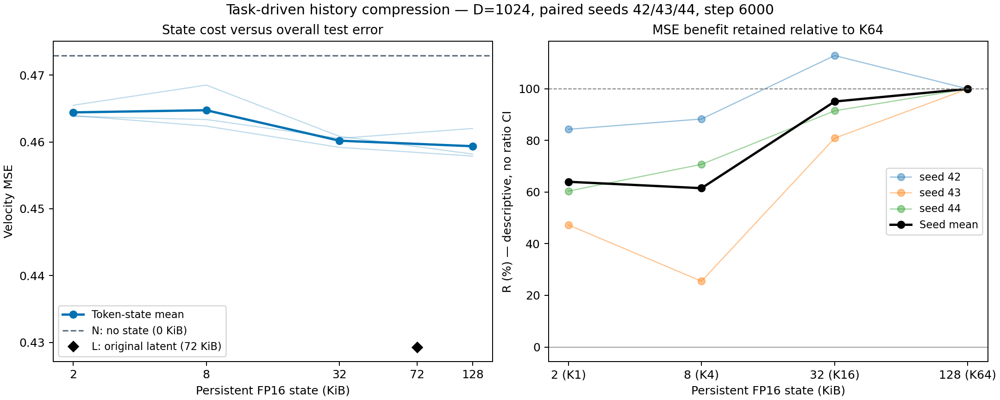

# 04 · 历史表示能压缩到多小？

[返回仓库首页](../../README.md) · [第三问：语义监督](../03_semantic_supervision/README.md)

后续实验已完成：[固定 16 个 token，压缩到 512／256／128 维](width_sweep/README.md)。其中 **16×256／8 KiB** 平均保留本页 K16 基准约 **96%** 的去噪收益，保留最初 K64 基准约 **91%** 的收益。

**首轮结果：状态从 128 KiB 压到 32 KiB，平均保留原 K64 相对无历史模型的 95.1% 去噪收益，测试 MSE 平均增加 0.18%。继续压到 8／2 KiB，收益保留率降至约 62%／64%。**

## 探究问题

第三问的十种子对照尚未显示额外 V-JEPA 对齐的稳定收益。本轮去掉教师特征和对齐损失，只用下一块去噪目标学习历史表示，研究 **状态大小与下一块去噪能力的关系**。

## 实验设计

历史编码器读取上一块 A 的 latent，输出 4×4×4 的特征网格。先将原始特征池化到指定网格，再逐 token 归一化。去噪器通过交叉注意力读取这个压缩状态，预测下一块 B 的速度场。

每个压缩档位都从头联合训练编码器和去噪器，让模型适应自己的容量；64-token 基准复用第三问中仅去噪监督的 C。全程只加载 VAE latent，不读取 V-JEPA 缓存。

| 组别 | 网格 T×H×W | token 数×维度 | FP16 状态大小 | 相对 64-token 基准压缩倍数 |
|---|---|---|---:|---:|
| K64 · 原 C 基准 | 4×4×4 | 64×1024 | 128 KiB | 1× |
| K16 | 4×2×2 | 16×1024 | 32 KiB | 4× |
| K4 | 4×1×1 | 4×1024 | 8 KiB | 16× |
| K1 | 1×1×1 | 1×1024 | 2 KiB | 64× |

先保持四个时间位置、压缩空间网格，最后再压到一个 token。交叉注意力实际读取 16、4 或 1 个 token。对应的位置参数按相同网格池化，编码器和去噪器的可训练参数总量保持 **14,829,968** 不变。

状态大小按 `token 数 × 1024 × 2 字节` 计算，指传给下一块的表示，不包含模型权重和训练激活。背景参考为无历史 N，以及保存完整上一块 latent 的 L；后者 FP16 大小为 **72 KiB**。

| 设置 | 数值 |
|---|---|
| 数据 | 相同的 UCF101 六类缓存 |
| 训练／验证／测试窗口 | 1,624／475／759 |
| 训练种子 | 42、43、44 |
| 新训练的模型 | 每个种子的 K16、K4、K1，共 9 个 |
| 每个模型 | 6,000 步，batch 16，BF16 |
| 优化器 | AdamW，学习率 2e-4，weight decay 0.01 |
| 条件 dropout | 10% |
| 训练目标 | 仅 flow matching；梯度回传到历史编码器 |
| 配对方式 | 同种子各容量共享初始化、训练样本、时间步、噪声和 dropout 掩码 |
| 最终评估 | 五档 t，每窗口四份固定噪声，使用第 6,000 步权重 |

## 看什么结果

主要画出 **状态 KiB—测试速度 MSE** 曲线，并比较相对 K64 的误差变化。再用无历史 N 作为起点，计算压缩后保留了多少去噪收益：

$$
R_K=\frac{E_N-E_K}{E_N-E_{64}}.
$$

这里的保留率表示 MSE 收益比例，可以低于零或超过 100%。它不表示保留了多少语义信息。所有比较统一使用相同的三个种子。

## 实验过程

同一种子内配对训练三个压缩模型，每 1,000 步记录验证误差。最终评估按噪声、窗口、视频、来源组、类别逐级平均，报告三个种子的均值与各自的来源组配对区间。

## 运行

在仓库根目录执行，复用现有 VAE 缓存和前三问的参考结果：

```bash
for seed in 42 43 44; do
  python experiments/04_history_compression/train.py --seed "$seed" --steps 6000
done

python experiments/04_history_compression/evaluate.py --split val --seeds 42 43 44
python experiments/04_history_compression/evaluate.py --split test --seeds 42 43 44
python experiments/04_history_compression/analyze.py --run-root runs --split test
```

输出保存在 `runs/history_compression_seed{seed}/`。训练中断后添加 `--resume`。

无需 GPU，可重画仓库附带的结果：

```bash
python experiments/04_history_compression/analyze.py
```

## 实验结果

三个种子的九个新模型均完成 6,000 步训练。下表是测试集的三种子均值；改善率和收益保留率先逐种子计算再平均。

| 组别 | 状态大小 | 测试 MSE ↓ | 相对 N 改善 ↑ | K64 去噪收益保留率 ↑ |
|---|---:|---:|---:|---:|
| N · 无历史 | 0 KiB | 0.472932 | — | — |
| K64 · 原 C | 128 KiB | 0.459365 | 2.87% | 100.0% |
| **K16** | **32 KiB** | **0.460189** | **2.69%** | **95.1%** |
| K4 | 8 KiB | 0.464750 | 1.73% | 61.5% |
| K1 | 2 KiB | 0.464426 | 1.80% | 64.0% |
| L · 完整上一块 latent | 72 KiB | 0.429315 | 9.22% | — |

K16 将状态缩小四倍，相对 K64 的测试误差平均增加 **0.18%**；K4、K1 分别增加 **1.17%**、**1.10%**。三个压缩档位相对无历史 N 的改善，在每个种子的来源组区间中都高于零。

收益保留率的逐种子结果：

| 种子 | K16 · 32 KiB | K4 · 8 KiB | K1 · 2 KiB |
|---|---:|---:|---:|
| 42 | 112.9% | 88.3% | 84.3% |
| 43 | 80.9% | 25.5% | 47.3% |
| 44 | 91.5% | 70.8% | 60.4% |

K16 在种子 42 略有改善，在 43、44 有小幅退化。验证集上，K16、K4、K1 相对 K64 的 MSE 分别平均增加 **0.36%、1.34%、1.41%**，同样显示较强压缩会损失更多预测能力。



**本轮结论：去掉对齐后，任务驱动表示仍能压缩到较小的状态。16 个 token／32 KiB 是当前较好的继续探索点：状态缩小四倍，平均保留约 95% 的原有去噪收益。4／1 个 token 仍然有用，但收益损失明显。** K1 与 K4 的逐种子排序不一致；当前结果不支持认定 1 个 token 普遍优于 4 个。完整历史 L 仍有更低的误差，收益保留率的参照始终是 K64。

## 文件

```text
04_history_compression/
├── README.md       # 问题、容量设置、命令与结果
├── model.py        # 历史编码器与可变 token 数的注意力
├── train.py        # K16 / K4 / K1 配对训练
├── evaluate.py     # 最终权重评估，复用原 K64 权重
├── analyze.py      # 汇总、容量曲线与收益保留率
└── results/        # 原始误差、汇总和结果图
```

详细测试结果见 [summary.csv](results/summary.csv)、[summary.json](results/summary.json)，验证结果见 [validation_summary.json](results/validation_summary.json)，配置和训练曲线见 [training.json](results/training.json)。
