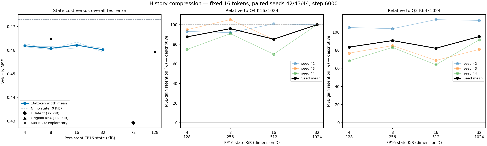

# 04B · 固定 16 个 token，继续压缩维度

[返回第四问](../README.md) · [返回仓库首页](../../../README.md)

**结果：固定 16 个 token 后，256 维／8 KiB 在本轮新增维度中表现最好。平均保留 16×1024 基准的 96.0% 去噪收益，以及最初 64×1024 基准的 90.7% 收益。相对前者，测试 MSE 平均增加 0.13%。**

## 探究问题

上一轮将 64 个 token 压到 16 个后，32 KiB 状态平均保留了原有去噪收益的 95.1%。本轮固定 **16 个 token**，将维度从 1024 降到 **512、256、128**，观察还能保留多少收益。

## 实验设计

历史编码器最后一层直接输出 D 维特征，按相同的 4×2×2 网格池化得到 16 个 token，再逐 token 归一化。去噪器的条件 LayerNorm 和投影层使用对应的 D 维输入；交叉注意力内部宽度仍为 256。

| 组别 | 状态形状 | FP16 状态大小 | 相对 16×1024 压缩倍数 | 可训练参数 |
|---|---|---:|---:|---:|
| D1024 · 上轮 K16 | 16×1024 | 32 KiB | 1× | 14,829,968 |
| D512 | 16×512 | 16 KiB | 2× | 14,567,312 |
| D256 | 16×256 | 8 KiB | 4× | 14,435,984 |
| D128 | 16×128 | 4 KiB | 8× | 14,370,320 |

状态大小按 `16 × D × 2 字节` 计算。维度减小同时缩小编码器输出层与条件投影层，因此参数量也略有下降。

D1024 复用上轮 K16 的最终权重，其余三档从头训练。初始化以同种子的原 K16 为基础：编码器输出层取前 D 行及对应偏置，条件投影取前 D 列并乘以 `sqrt(1024/D)`，保持 fan-in 初始化尺度；其余权重相同。

| 设置 | 数值 |
|---|---|
| 数据与划分 | 相同的 UCF101 六类 VAE 缓存；训练／验证／测试 1,624／475／759 窗口 |
| 种子与模型数 | 42、43、44；各训练三种新维度，共 9 个模型 |
| 每个模型 | 6,000 步，batch 16，BF16 |
| 优化器 | AdamW，学习率 2e-4，weight decay 0.01 |
| 条件 dropout | 10% |
| 训练目标 | 仅下一块 flow matching；不读取教师特征，无对齐损失 |
| 配对方式 | 同种子共享训练样本、时间步、噪声与 dropout 掩码 |
| 最终评估 | 五档 t，每窗口四份固定噪声，第 6,000 步权重 |

## 看什么结果

首先比较各维度的测试速度 MSE，以及相对 D1024 的误差变化。收益保留率分别使用两个参照：

$$
R_{16,D}=\frac{E_N-E_{16,D}}{E_N-E_{16,1024}},\qquad
R_{\mathrm{original},D}=\frac{E_N-E_{16,D}}{E_N-E_{64,1024}}.
$$

第一项回答本次降维保留了多少上轮 16-token 的收益；第二项回答从最初 64×1024 一路压缩后，还保留多少原始收益。两者均先按种子计算，再取均值，不表示语义信息比例。

## 实验过程

同一种子内配对训练三种维度，每 1,000 步记录验证误差。最终按噪声、窗口、视频、来源组、类别逐级平均，报告三个种子的均值及各自的来源组配对区间。

## 运行

在仓库根目录执行：

```bash
for seed in 42 43 44; do
  python experiments/04_history_compression/width_sweep/train.py --seed "$seed" --steps 6000
done

python experiments/04_history_compression/width_sweep/evaluate.py --split val --seeds 42 43 44
python experiments/04_history_compression/width_sweep/evaluate.py --split test --seeds 42 43 44
python experiments/04_history_compression/width_sweep/analyze.py --run-root runs --split test
```

输出保存到 `runs/history_width_seed{seed}/`。训练中断后添加 `--resume`。

无需 GPU，可重画仓库附带的结果：

```bash
python experiments/04_history_compression/width_sweep/analyze.py
```

## 实验结果

三个种子的九个新模型均完成 6,000 步训练。以下为测试集三种子均值；改善率和两种保留率均先逐种子计算，再取平均。

| 维度 D | 状态大小 | 测试 MSE ↓ | 相对 N 改善 ↑ | 相对 16×1024 的收益保留率 | 相对原 64×1024 的收益保留率 |
|---|---:|---:|---:|---:|---:|
| 1024 · 上轮 K16 | 32 KiB | 0.460189 | 2.69% | 100.0% | 95.1% |
| 512 | 16 KiB | 0.462125 | 2.28% | 85.2% | 82.2% |
| **256** | **8 KiB** | **0.460773** | **2.57%** | **96.0%** | **90.7%** |
| 128 | 4 KiB | 0.461860 | 2.34% | 87.6% | 83.4% |

D512、D256、D128 相对 D1024 的测试 MSE 分别平均增加 **0.42%、0.13%、0.36%**。验证集分别增加 **0.48%、0.05%、0.38%**，新增维度中同样是 D256 的均值最好。

相对 16×1024 的逐种子收益保留率：

| 种子 | D512 | D256 | D128 |
|---|---:|---:|---:|
| 42 | 100.8% | 91.9% | 93.1% |
| 43 | 85.0% | 105.2% | 94.9% |
| 44 | 69.9% | 90.8% | 74.7% |

D256 在种子 43 略有改善，在 42、44 有小幅退化；三个种子相对无历史 N 的改善区间均高于零。维度曲线并不单调，D256 也并非每个种子的最佳新增维度。



**同为 8 KiB 的补充比较：** 16×256 的测试 MSE 为 **0.460773**，上轮 4×1024 为 **0.464750**，前者平均改善 **0.85%**。三个种子的改善分别为 0.38%、1.76%、0.41%，各自的来源组区间均高于零。这是本轮的探索性结构比较。

**本轮结论：16×256／8 KiB 是当前较好的继续探索点。相对上轮 32 KiB 再压缩四倍，平均保留约 96% 的收益；相对最初 128 KiB 状态，累计压缩十六倍，保留约 91% 的原有收益。** 16×128／4 KiB 还能进一步减小状态，原有收益保留率约为 83%。这些保留率描述去噪误差收益，不代表语义信息量。

## 文件

```text
width_sweep/
├── README.md       # 维度设置、命令与结果
├── width_model.py  # 可变维度的历史编码器与条件投影
├── train.py        # D512 / D256 / D128 配对训练
├── evaluate.py     # 最终权重评估，复用 D1024
├── analyze.py      # 统计与容量曲线
└── results/        # 原始误差、汇总与结果图
```

详细测试结果见 [summary.csv](results/summary.csv)、[summary.json](results/summary.json)，验证结果见 [validation_summary.json](results/validation_summary.json)，配置和训练曲线见 [training.json](results/training.json)。
