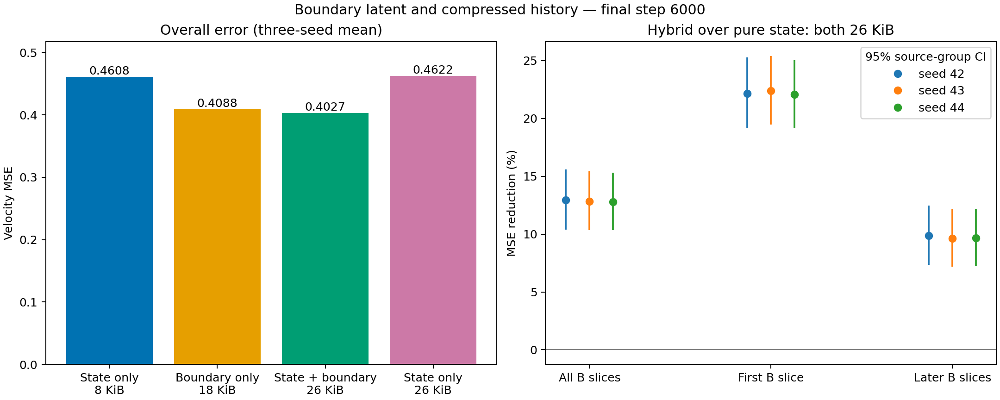
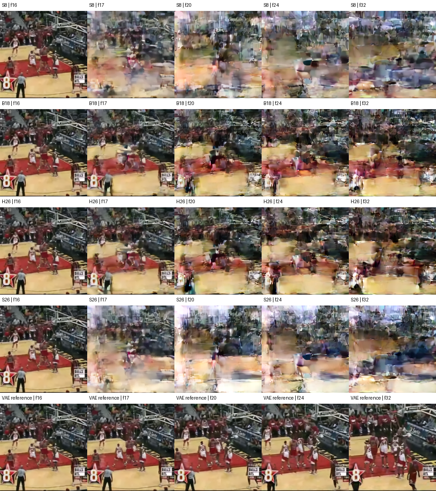

# 05 · 压缩表示与边界 latent 是否互补？

[返回仓库首页](../../README.md) · [上一轮：维度压缩](../04_history_compression/width_sweep/README.md)

**结果：26 KiB 的“压缩表示＋边界 latent”比等预算纯表示降低 12.87% 的测试去噪 MSE，比仅边界再降低 1.48%。三个种子方向一致。边界带来主要收益，压缩表示仍提供额外收益，且后续时间片的增益更大。**

## 探究问题

用较小的任务驱动表示保存历史，再保留上一视频块最后一个 latent 时间切片，能否更好地指导下一块去噪？在相同状态预算下，这种组合是否优于只保存压缩表示？

## 实验设计

| 组别 | 条件 | FP16 状态大小 |
|---|---|---:|
| 仅压缩表示 S8 | 16×256 表示，复用上一轮权重 | 8 KiB |
| 仅边界 B18 | A 最后一个 latent 时间切片，16×1×24×24 | 18 KiB |
| 表示＋边界 H26 | 8 KiB 表示＋18 KiB 边界 | 26 KiB |
| 等预算纯表示 S26 | 16×832 表示 | 26 KiB |

**主比较是 H26 与 S26，两者均为 26 KiB。** S8、B18 是组成部分参照；四组并非都使用相同容量。

压缩表示通过现有交叉注意力输入。边界切片通过现有历史 latent 输入通道广播到 B 的四个时间位置；只保存一个 FP16 切片，广播用于当前前向。S8/S26 的历史 latent 通道置零，B18 的表示条件置零。B18 不运行历史编码器。

所有组仅用下一块 flow-matching 损失，不读取 V-JEPA 特征。三个新组从头训练，沿用此前初始化规则、数据划分和噪声协议。H26 的表示与边界使用同一条件 dropout 掩码。

| 设置 | 数值 |
|---|---|
| 数据 | UCF101 六类；训练／验证／测试 1,624／475／759 窗口 |
| 训练种子 | 42、43、44 |
| 新模型 | B18、H26、S26，每组 3 个种子，共 9 个 |
| 每个模型 | 6,000 步，batch 16，BF16，AdamW lr 2e-4、weight decay 0.01 |
| 条件 dropout | 10%；H26 联合丢弃两种历史条件 |
| 最终评估 | 第 6,000 步权重；五档 t、每窗口四份固定噪声 |
| 区域指标 | 整个 B、B 的首个 latent 时间片、后续三个时间片 |

各组共享去噪器主体；表示输出维度不同、B18 编码器不参与训练，实际参数量记录在各运行的配置中。状态大小不含模型权重、训练激活及 VAE 解码状态。

## 实验过程

同种子三个新组共享样本、时间步、噪声和 dropout 掩码，每 1,000 步记录验证误差。最终按噪声、窗口、视频、来源组、类别逐级平均，并报告逐种子的来源组配对区间。

另固定种子 42，在每类按 ID 顺序选择第一个测试窗口，以相同初始噪声、32 步 Euler 生成 B。四组都使用同一真实 A 前缀进行 VAE 解码，去噪器的历史条件仍严格按上表限制。视频仅用于定性检查，不将首片 MSE 当作视觉连续性指标。

## 运行

在仓库根目录执行，沿用已有 VAE 缓存和第四问的权重：

```bash
for seed in 42 43 44; do
  python experiments/05_boundary_state/train.py --seed "$seed" --steps 6000
done

python experiments/05_boundary_state/evaluate.py --split val
python experiments/05_boundary_state/evaluate.py --split test
python experiments/05_boundary_state/analyze.py --run-root runs --split test
python experiments/05_boundary_state/sample.py --seed 42 --steps 32
```

训练输出在 `runs/boundary_state_seed{seed}/`，中断后加 `--resume`。固定样例保存在种子 42 运行目录的 `samples/`。

## 实验结果

九个新模型均完成 6,000 步训练。以下为测试集三个种子的均值，误差越低越好；改善率先逐种子计算，再取平均。

| 条件 | FP16 状态 | 整块 B MSE ↓ | B 首个 latent 时间片 | B 后续三个时间片 |
|---|---:|---:|---:|---:|
| 仅压缩表示 S8 | 8 KiB | 0.460773 | 0.463147 | 0.459981 |
| 仅边界 B18 | 18 KiB | 0.408761 | 0.365331 | 0.423237 |
| **表示＋边界 H26** | **26 KiB** | **0.402712** | **0.361821** | **0.416342** |
| 等预算纯表示 S26 | 26 KiB | 0.462186 | 0.465169 | 0.461191 |

| 组合组相对谁改善 | 整块 B | 首片 | 后续三片 |
|---|---:|---:|---:|
| 等预算纯表示 S26 | **12.87%** | 22.22% | 9.72% |
| 仅边界 B18 | **1.48%** | 0.96% | 1.63% |
| 8 KiB 纯表示 S8 | 12.60% | 21.88% | 9.49% |

主比较及边界之上额外收益的逐种子结果如下。括号内是来源组配对 bootstrap 的 95% 区间，表示测试来源组的抽样波动。

| 种子 | 组合组相对等预算纯表示 | 组合组相对仅边界 |
|---|---:|---:|
| 42 | 12.97% [10.37%, 15.58%] | 1.60% [1.27%, 1.91%] |
| 43 | 12.84% [10.35%, 15.41%] | 1.18% [0.88%, 1.50%] |
| 44 | 12.80% [10.34%, 15.32%] | 1.66% [1.37%, 1.93%] |

验证集方向一致：组合组相对等预算纯表示改善 **9.26%**，相对仅边界改善 **1.15%**。在测试集上，仅边界也比 8 KiB 纯表示改善 **11.29%**；把纯表示从 8 KiB 增到 26 KiB 则没有改善，平均 MSE 反而增加约 **0.31%**。



**本轮支持保留“小型压缩状态＋最近边界”的方向。** 近邻边界提供主要的预测线索，压缩表示在此基础上仍有稳定的额外去噪收益；其增益从首片的 0.96% 增至后续片的 1.63%。这回答了相邻两块条件是否互补；递归更新和长视频滚动生成留待后续问题验证。

完整数据见 [测试统计](results/summary.json)、[逐种子比较](results/summary.csv)、[验证统计](results/validation_summary.json) 和 [训练记录](results/training.json)。

## 固定生成样例

种子 42，每类取排序后的第一个测试窗口，四组共享初始噪声、32 步 Euler。视频前 17 帧为已观测前缀，后 16 帧为生成的下一块。`VAE reference` 是真实缓存 latent 的重建。

| 类别 | 视频 | 帧对照 |
|---|---|---|
| BasketballDunk | [播放](results/samples/case01.mp4) | [查看](results/samples/case01.png) |
| Diving | [播放](results/samples/case02.mp4) | [查看](results/samples/case02.png) |
| GolfSwing | [播放](results/samples/case03.mp4) | [查看](results/samples/case03.png) |
| LongJump | [播放](results/samples/case04.mp4) | [查看](results/samples/case04.png) |
| TennisSwing | [播放](results/samples/case05.mp4) | [查看](results/samples/case05.png) |
| VolleyballSpiking | [播放](results/samples/case06.mp4) | [查看](results/samples/case06.png) |

六组帧对照中，带边界的两组通常更好地保留场地布局、背景颜色和人物起始位置；纯表示组在 B 开始时更容易改变空间布局。组合组与仅边界组的视觉差异较小，当前样例仍有明显模糊、人物变形与运动偏差，不能据此断言动作质量已经改善。

以下为按固定顺序排列的第一个案例。行依次为 S8、B18、H26、S26、VAE 重建；列为第 16、17、20、24、32 帧（从 0 计数），第 16 帧是共同的已观测前缀末帧。



样例 ID、噪声种子和解码方式见 [样例记录](results/samples/manifest.json)。

## 文件

```text
05_boundary_state/
├── README.md
├── model.py       # 四种历史条件及按时间片评估
├── train.py       # B18 / H26 / S26 配对训练
├── evaluate.py    # 复用 S8 的最终权重
├── analyze.py     # 整体／首片／后续片统计与图表
├── sample.py      # 六个固定案例的配对采样和解码
└── results/       # 原始误差、汇总、结果图及样例
```
