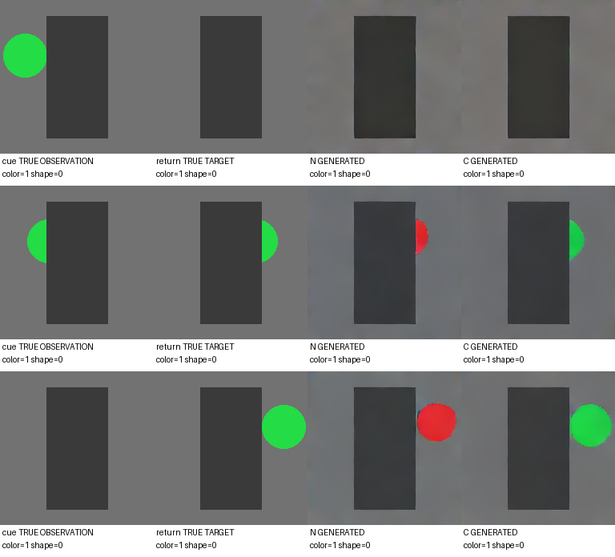
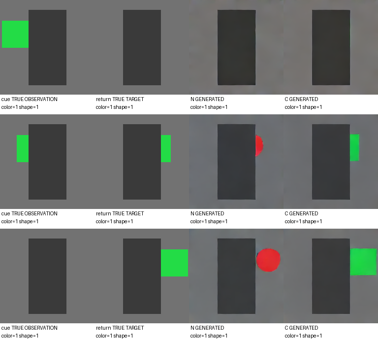

# 问题 6：压缩历史能否控制下一块生成？

[返回仓库首页](../../README.md) · [上一问：压缩表示与边界](../05_boundary_state/README.md)

固定首块的 **16×256、FP16 8 KiB** 历史表示，加上相同的全遮挡边界，在合成物体保持任务中控制下一块生成。seed 42、每组 6,000 步下，压缩历史组的颜色／形状联合正确率为 **99.79%**，无历史组为 **5.00%**。

## 设计

192×192、每块 16 帧、12 fps，四种颜色与三种形状。物体直径 48–56 像素；流程为观察物体进入遮挡板、一个真实全遮挡块、生成物体重现。只保留 keep；首块状态固定，不做递归更新。真实空白块独立经 Wan VAE 编码，只提供其最后一个 latent 时间片作为边界。

训练／验证／测试分别 1,000／200／300 个场景对。同一对共享背景、几何与运动，只改变颜色或形状，两种变化各占一半。各视频块独立 VAE 编码，VAE 冻结。

| 组别 | 可用历史 | FP16 有效历史负载 |
|---|---|---:|
| N | 压缩状态恒零，仅空白块边界 | 18 KiB |
| C | 固定首 cue 的 16×256 表示＋相同边界 | 26 KiB |

模型保持编码器、首次门控 U(0,E)、阶段嵌入与去噪器不变，共 14,633,616 个参数。N 不执行历史编码。两组从相同参数初始化，使用同一场景批次、噪声、t 与 dropout；配对变体也共享随机量。

仅预测 return；每步 8 场景对、16 个目标，每组 6,000 步。AdamW lr=2e-4、weight_decay=0.01、梯度裁剪=1、条件 dropout=10%、BF16。t=0 为纯噪声；t 从 0.5×U(0,0.2)＋0.5×U(0,1) 采样。

速度场平方误差先对通道平均，再分别对前景、背景在整个目标 chunk 内归一化，各占总损失的 50%。可见物体 mask 映射到 latent 网格并扩展一格空间边缘，仅用于损失。

## 评价

固定 60 个完整测试场景对，32 步 Euler 从纯噪声采样，无额外 CFG。报告最后 8 帧的物体出现率、颜色／形状正确率、联合正确率和空间 IoU。颜色与形状分类不受目标位置 IoU 门限限制，缺失物体计错；VAE 真值重建与程序真值同时用于检查指标。

C 额外评估状态置零、配对状态交换。由于同一对的边界和噪声相同，交换状态等价于另一个变体的正常采样，直接复用其结果；N 与 C-zero 的同对变体也复用生成与解码。交换结果不当作独立重复样本。

单模型分别测训练耗时与峰值显存，以及 batch=1 的条件编码、32 步采样耗时和推理峰值显存。实际条件张量占用单独统计：N 的模型接口仍需要 8 KiB 全零占位，因此不能把 18 KiB 有效负载当成全部张量占用。VAE 时间与峰值显存单列。视频并排展示真实 cue、真实目标、N 生成与 C 生成。

## 复现

先按[仓库安装说明](../../README.md#installation)安装依赖。此实验使用程序生成数据，只需 Wan VAE，无需 UCF101 或 V-JEPA。以下命令均在仓库根目录执行。

```bash
mkdir -p models/wan-vae
for file in config.json diffusion_pytorch_model.safetensors; do
  curl -fL --retry 3 -C - \
    "https://huggingface.co/Wan-AI/Wan2.1-T2V-1.3B-Diffusers/resolve/dd9313515fdad8a9fcef162db68309090805ed30/vae/$file" \
    -o "models/wan-vae/$file"
done

# 数据生成与编码 → 配对训练 → 生成评估 → 资源复测
mkdir -p experiments/06_condition_generation/logs
nohup python -u experiments/06_condition_generation/run.py \
  > experiments/06_condition_generation/logs/pipeline.log 2>&1 < /dev/null &

cat experiments/06_condition_generation/logs/status.json
tail -n 3 experiments/06_condition_generation/logs/train.log
```

也可分步执行：

```bash
python experiments/06_condition_generation/data.py --device cuda --batch-size 4
python experiments/06_condition_generation/train.py --seed 42 --steps 6000 --arms N C
python experiments/06_condition_generation/evaluate.py --seed 42 --pairs 60 --device cuda --preview-pairs 4
python experiments/06_condition_generation/benchmark.py
```

数据缓存、训练输出与日志分别写入实验目录下的 `cache/`、`runs/seed42/` 和 `logs/`；结果写入 `results/seed42/`。训练检查点与缓存不随仓库分发。

## Seed 42 结果

两组均完成 6,000 步。固定 60 个测试场景对、120 段视频，颜色／形状指标对每段最后 8 帧评分后平均。配对成功要求两种线索对应的输出都在严格多数帧上正确。

| 指标 | N 无历史 | C 压缩历史 |
|---|---:|---:|
| 物体出现率 | 100.00% | 100.00% |
| 颜色正确率 | 20.83% | **100.00%** |
| 形状正确率 | 33.33% | **99.79%** |
| 颜色与形状同时正确 | 5.00% | **99.79%** |
| 空间 IoU | 0.3664 | **0.9217** |
| 配对两条输出均正确 | 0/60 | **60/60** |

将 C 的状态置零，颜色正确率降为 25.00%，形状为 33.65%，联合正确率为 8.96%。交换配对历史状态后，输出跟随 donor 的颜色／形状（分别 100.00%／99.79%）；同噪声下，此结果直接复用 donor 的正常输出。

独立验证集的 36 个 VAE 真值重建样本（每种属性 3 个），颜色／形状识别均为 100%，空间 IoU 为 0.9760。C 的两个错误来自 960 个评分帧中的两个形状判断；这些帧不是独立训练种子。

视频中，N 对同一配对输出相同的物体，C 能跟随线索改变颜色或形状，并较好保持位置。**本轮确认了固定 8 KiB 压缩历史在这个保持任务中能够控制单块生成。** 本轮为单种子、固定首块、单块生成，未做递归更新。

## 资源结果

| 指标 | N 无历史 | C 压缩历史 |
|---|---:|---:|
| 6,000 步训练时间 | 288.55 s | 322.99 s |
| 训练峰值 allocated 显存 | 530.3 MiB | 562.5 MiB |
| 首块表示编码，batch=1 | 跳过 | 0.97 ms |
| 单块 32 步采样，batch=1 | 152.78 ms | 151.39 ms |
| 生成器推理峰值 allocated 显存 | 93.7 MiB | 93.7 MiB |
| 有效历史负载（含边界） | 18 KiB | 26 KiB |
| 实际持久条件张量（含全零占位） | 26 KiB | 26 KiB |

采样速度基本相同；C 额外编码约 1 ms。首次计时未稳定，后以 N/C/C/N 顺序独立加载，每次预热 5 次、测 10 次，取每组 20 次的中位数；原始首测与复测均保留。复测由 `benchmark.py` 完成。

VAE 单独加载，峰值 allocated 显存约 1.24 GiB；240 个唯一生成块的 VAE 解码共 58.80 秒。数据编码约 19.8 分钟，完整数据→训练→评估流程约 33.0 分钟，不含代码实现与后续复测。

## 查看结果

- [完整指标](results/seed42/summary.json) · [指标表](results/seed42/metrics.csv) · [逐样本结果](results/seed42/cases.json)
- [数据配置](results/seed42/data_config.json) · [测试场景清单](results/seed42/manifest.json) · [识别校准](results/seed42/calibration.json)
- [训练配置](results/seed42/training/config.json) · [训练曲线数据](results/seed42/training/metrics.jsonl) · [N 训练资源](results/seed42/training/resource_N.json) · [C 训练资源](results/seed42/training/resource_C.json)
- [资源记录](results/seed42/resources.json) · [采样计时复测](results/seed42/timing_recheck.json)
- 同色换形状：[圆形线索视频](results/seed42/samples/test_00002_v0.mp4) · [方形线索视频](results/seed42/samples/test_00002_v1.mp4)
- 同形状换颜色：[颜色变体一](results/seed42/samples/test_00000_v0.mp4) · [颜色变体二](results/seed42/samples/test_00000_v1.mp4)
- [全部 8 段样例索引](results/seed42/samples/manifest.json)

每段视频四列依次为真实 cue、真实目标、N 生成、C 生成。帧对照：




