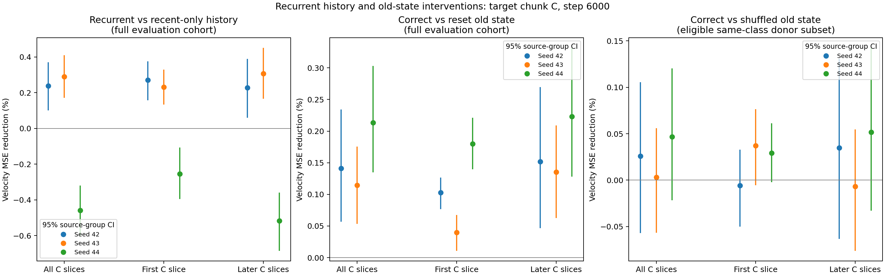

# 06 · 递归状态能否利用更早的历史？

[返回仓库首页](../../README.md) · [上一问：压缩表示与边界](../05_boundary_state/README.md)

**结果：递归组相对仅最近块组的测试 MSE 平均改善 0.022%，两个种子改善、一个退化，尚未显示稳定优势。清空旧状态会小幅变差，但正确旧状态相对同类错误旧状态的优势很小且区间跨零，尚未证明有效利用了当前视频特有的更早历史。**

## 探究问题

预测 C 时，已知相同的最近视频块 B 和 B 的边界 latent，递归更新的状态能否保留来自 A、对 C 去噪有用的信息？

## 实验设计

采用连续 A→B→C，每块 16 帧；加上 VAE 起始帧，共 49 帧，12 fps、192×192。从原 UCF101 六类视频提取新窗口，沿用原视频的来源组划分。两组在完全相同的新窗口上重新训练。

新窗口数量：训练 1,118 条（292 视频、76 来源组），验证 296 条（77 视频、19 来源组），测试 460 条（125 视频、32 来源组）。

| 组别 | A 后的状态 | B 后用于预测 C 的状态 |
|---|---|---|
| 仅最近块 recent | U(E(A), 0) | U(E(B), 0) |
| 递归更新 recurrent | U(E(A), 0) | U(E(B), m_A) |

E 复用第四、五问的 16×256 历史编码器结构。U 是共享的逐 token GRUCell(256, 256)，两组具有相同的模型结构、名义参数量和初始化；最近块组每次更新前清零旧状态。每条序列两组各调用两次编码器和更新器，均预测 B 和 C。递归组的梯度经过 A→B 状态链回传。

状态保存为 FP16 的 16×256 token（8 KiB），另保存最近块的最后一个 latent 时间片（18 KiB），总共 26 KiB。去噪器仍通过交叉注意力读取状态，通过已有历史通道读取广播后的边界。不拼接历史 token，不使用 V-JEPA。

历史始终来自真实视频。本轮测显式递归状态的额外价值；最近块 latent 本身由因果 VAE 编码，也可能携带编码器过去的上下文。

| 设置 | 数值 |
|---|---|
| 种子 | 42、43、44 |
| 训练 | 每组 6,000 步，batch 8 条序列，即 16 个预测目标 |
| 损失 | B、C 的 flow-matching 损失等权平均 |
| 优化器 | AdamW lr 2e-4、weight decay 0.01、grad clip 1 |
| 精度 | BF16 前向，FP32 损失，FP16 跨块状态 |
| 条件 dropout | 10%，联合丢弃去噪器读取的状态和边界，不清空内部递归链 |
| 主指标 | 最终权重的 C 整体速度 MSE |
| 评估 | 五档 t，每窗口四份固定噪声；同种子各条件共享噪声 |

## 旧状态干预

在同一个训练好的递归模型内，更新 B 时分别输入正确的 m_A、零状态、同类其他来源视频的 m_A。B、边界、C 的噪声和时间步不变。清空的是旧状态，不是已经包含 B 的最终状态。

主比较和清空状态比较使用全部测试窗口。错配比较只使用同类中存在其他来源视频的窗口，并在这个相同子集上重新计算正确状态的误差。四秒测试片段中，BasketballDunk 仅剩一个视频，因而不进入错配比较。原始结果中的 `donor_valid` 标记可用窗口；无合适 donor 的占位输出不参与错配统计。

主要比较最近块组与递归组；零状态、错配状态用来判断收益是否依赖正确的更早历史。预测 B 时没有跨块历史积累，只作为辅助参照。另统计 C 的首个 latent 时间片与后续三片。

按噪声、窗口、视频、来源组、类别逐级平均；每个种子做来源组配对 bootstrap，三个训练种子分别报告。状态干预与独立训练对照共同解释，不单凭错配后退化判断记忆有效。

## 运行

在仓库根目录执行：

```bash
python experiments/06_recurrent_state/prepare_cache.py
for seed in 42 43 44; do
  python experiments/06_recurrent_state/train.py --seed "$seed" --steps 6000
done
python experiments/06_recurrent_state/evaluate.py --split val
python experiments/06_recurrent_state/evaluate.py --split test
python experiments/06_recurrent_state/analyze.py --run-root runs --split test
```

缓存位于 `cache/ucf6_12fps_192_abc/`，训练输出位于 `runs/recurrent_state_seed{seed}/`。缓存可续提，训练中断后添加 `--resume`。

## 实验结果

六个模型均完成 6,000 步。新缓存提取约 15 分钟，三种子并行训练约 13 分钟，随后进行固定最终权重的验证和测试。以下改善率均先逐种子计算再平均。

### C 的主比较

完整测试集：460 窗口、125 视频、32 来源组、六类。

| 条件 | 状态＋边界 | C 整体 MSE ↓ | 首个 latent 时间片 | 后续三个时间片 |
|---|---:|---:|---:|---:|
| 仅最近块 | 26 KiB | 0.430197 | 0.380523 | 0.446755 |
| 递归更新 | 26 KiB | 0.430099 | 0.380207 | 0.446730 |
| 递归模型，更新 B 前清空旧状态 | 26 KiB | 0.430773 | 0.380617 | 0.447491 |

递归相对仅最近块平均改善 **0.022%**，种子间标准差 **0.418 个百分点**。首片改善 0.083%，后续三片改善 0.005%。验证集平均改善为 **−0.012%**，也基本持平。

| 种子 | 递归相对仅最近块改善 | 95% 来源组配对区间 |
|---|---:|---:|
| 42 | +0.237% | [+0.101%, +0.370%] |
| 43 | +0.289% | [+0.171%, +0.409%] |
| 44 | −0.460% | [−0.601%, −0.321%] |

### 旧状态是否提供正确历史信息？

在完整测试集上，正确旧状态相对清零平均改善 **0.156%**，三个种子的区间均高于零。

错配比较只使用具备同类异来源 donor 的五类、456 窗口、124 视频、31 来源组。以下两行严格使用同一个子集，不与上表六类 MSE 直接比较。

| 递归模型的旧状态 | 子集上的 C MSE ↓ |
|---|---:|
| 正确视频的 A 状态 | 0.406501 |
| 同类其他视频的 A 状态 | 0.406604 |

| 种子 | 正确相对清零改善（完整集） | 正确相对错配改善（可配对子集） |
|---|---:|---:|
| 42 | +0.141% [+0.057%, +0.234%] | +0.026% [−0.057%, +0.105%] |
| 43 | +0.114% [+0.053%, +0.176%] | +0.003% [−0.057%, +0.056%] |
| 44 | +0.213% [+0.135%, +0.303%] | +0.047% [−0.022%, +0.120%] |

正确旧状态相对错配平均改善只有 **0.025%**，三个种子的来源组区间均跨零。验证集上，正确状态相对清零、错配分别改善 0.168%、0.078%。



**本轮发现了旧状态敏感性，但尚未证明稳定的递归预测收益，也尚未证明保留并利用了特定的较早历史。** 清空状态后的退化也可能来自状态分布变化，不能单独解释为记住了 A 的具体内容。B 位置的测试均值为最近块 0.426207、递归 0.426466；该位置本来没有跨块积累，差异反映训练后参数的变化。

完整数据：[测试统计](results/summary.json)、[逐种子比较](results/summary.csv)、[验证统计](results/validation_summary.json)、[训练记录](results/training.json)、[数据统计](results/dataset_summary.json)。

无需 GPU，可以重画已有结果：

```bash
python experiments/06_recurrent_state/analyze.py
```
