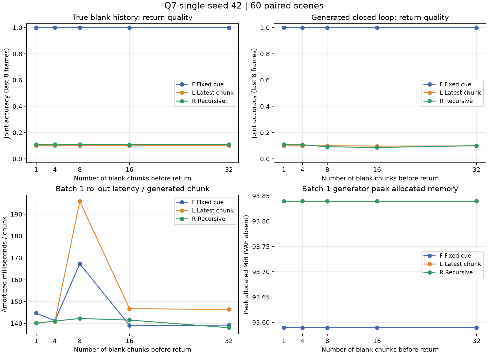

# 问题 7：递归更新能否保留更早的历史？

[返回仓库首页](../../README.md) · [上一问：压缩历史控制生成](../06_condition_generation/README.md)

**seed 42、每组 6,000 步：固定首块表示在 32 个生成遮挡块后仍达到 100% 颜色／形状联合正确率；最近块组为 9.79%，本次简单门控递归组为 10.00%。当前递归组在只有一个真实遮挡块时也仅为 10.94%，没有学会有效的属性保持。**

## 实验问题与设计

问题 6 已验证固定首块压缩表示能够控制物体重现。本轮比较“只编码最近块”和“结合旧状态递归更新”，同时加入生成块闭环，观察更新后的状态能否保留更早的颜色、形状与位置。

沿用问题 6 的物体保持任务：192×192、每块 16 帧、12 fps，四种颜色、三种形状，物体直径 48–56 像素。训练／验证／测试分别为 1,000／200／300 个场景对。同一对只改变颜色或形状，背景、几何和运动相同。无 V-JEPA 对齐，表示由生成任务训练得到。

| 组别 | 状态更新方式 | 持久历史条件 |
|---|---|---:|
| F · 固定首块 | 首次编码后保持状态不变 | 8 KiB 状态＋18 KiB 最近边界 |
| L · 最近块 | 每次只用当前块，`U(0,E(current))` | 同上 |
| R · 递归更新 | 当前块与旧状态融合，`U(old,E(current))` | 同上 |

状态为 16×256、FP16，边界为最近块的最后一个 latent 时间片。三组都从 `U(0,E(cue))` 开始；门控更新为 `g=sigmoid(MLP([old,E]))`、`s=(1-g)*old+g*E`。模型均为 14,633,616 个参数，从相同初始化训练。

训练随机使用 1–4 个真实遮挡块，状态全程反向传播。每步保留 8 场景对、16 个重现目标，前景／背景误差分别归一化后各占一半；另加 8 个遮挡目标，损失为 `return_loss + 0.1*blank_MSE`。预测遮挡块时，条件只包含该块之前的历史。AdamW、学习率 2e-4、10% 条件 dropout 和高噪声采样方式沿用问题 6。三组共用场景、噪声和随机延迟，各训练 6,000 步。

测试固定 60 个完整场景对，在 1、4、8、16、32 个遮挡块后生成重现块，每块使用 32 步 Euler。分别测试真实遮挡历史与生成历史闭环：

```text
真实 cue → s0
s0 + cue 边界 → 生成 blank1 → 更新 s1 与边界
s1 + 最近边界 → 生成 blank2 → 更新 s2 与边界 → …
在指定长度处分支生成 return；return 不反馈到后续遮挡历史。
```

32 个遮挡块约 42.7 秒，包含 cue 和 return 的完整样例为 45.3 秒。三组及配对变体共用采样噪声。F、L 的真实历史条件在各长度下相同，对应结果复用。

## 质量结果

联合正确率是每段重现视频最后 8 帧中，颜色与形状同时正确的比例，再对 120 段视频平均。缺失物体计错。配对成功要求同一场景的两个属性变体都在严格多数帧上正确。

| 遮挡块数 | F 真实历史 | F 生成闭环 | L 真实历史 | L 生成闭环 | R 真实历史 | R 生成闭环 |
|---:|---:|---:|---:|---:|---:|---:|
| 1 | 100.00% | 100.00% | 10.00% | 9.90% | 10.94% | 10.94% |
| 4 | 100.00% | 100.00% | 10.00% | 9.90% | 10.94% | 10.73% |
| 8 | 100.00% | 100.00% | 10.00% | 10.00% | 10.94% | 9.17% |
| 16 | 100.00% | 100.00% | 10.00% | 9.69% | 10.83% | 8.65% |
| 32 | 100.00% | 100.00% | 10.00% | 9.79% | 10.94% | 10.00% |

所有长度、两种历史方式下，F 配对成功均为 **60/60**，L、R 均为 **0/60**。32 块闭环的空间 IoU 分别为 F **0.9320**、L **0.3612**、R **0.3399**。评分器对 36 个验证集 VAE 真值重建样本的颜色与形状识别均为 100%。

R 在 return 阶段额外替换边界和清零状态：

| 遮挡块数 | 正常闭环 | 换成真实空白边界 | 真实空白边界＋状态清零 |
|---:|---:|---:|---:|
| 1 | 10.94% | 10.83% | 9.79% |
| 32 | 10.00% | 10.94% | 9.79% |

**这一版递归没有跑通属性保持，而且短程真实历史中已经失败，因此主要问题不能归因于长序列闭环误差累积。** 当前数据还不能区分状态更新丢失信息、去噪器未有效读取状态或训练优化不足。固定首块的结果说明：本任务中，8 KiB 表示能够跨越长遮挡控制重现；接下来应先让递归组通过短程保持，再讨论更长序列。

长遮挡期间，生成背景和挡板存在亮度漂移。F/L/R 的遮挡 latent MSE 从第 1 块的 0.0051/0.0062/0.0069 增至第 32 块的 0.0444/0.0522/0.0713。选取的两对遮挡样例未检测到可见彩色物体；该检查不代表全部测试视频。上述 100% 指重现属性正确率。



## 资源结果

RTX 4080 实例，batch 1；生成器与 VAE 分开运行。推理耗时包含 cue 编码、遮挡块生成与状态更新、最后一个 return，再除以生成块数。每个长度测三次，取中位数。

| 指标 | F 固定首块 | L 最近块 | R 递归 |
|---|---:|---:|---:|
| 6,000 步训练耗时 | 359.15 s | 339.33 s | 356.37 s |
| 训练峰值 allocated 显存 | 729.1 MiB | 748.8 MiB | 792.4 MiB |
| 32 块遮挡时，平均每生成块耗时 | 139.23 ms | 146.43 ms | 138.03 ms |
| 生成器推理峰值 allocated 显存 | 93.6 MiB | 93.8 MiB | 93.8 MiB |
| 1–32 块下的持久条件张量 | 26 KiB | 26 KiB | 26 KiB |

三组的持久状态与推理峰值显存均未随长度增长。VAE 单独运行的峰值 allocated 显存约 1.24 GiB。计时存在波动，不据此给三组速度排名；首测和加入完整长 rollout 预热后的复测原值均保留。状态大小不包含模型权重、采样工作张量或输出视频。

## 视频

每段视频三列依次为 **F / L / R**，上行为真实历史，下行为生成闭环。cue 是真实输入，重现块均为生成结果。

| 初始属性 | 4 块遮挡 | 32 块遮挡 | 32 块帧对照 |
|---|---|---|---|
| 绿色圆形 | [视频](results/seed42/samples/test_00002_v0_d4.mp4) | [视频](results/seed42/samples/test_00002_v0_d32.mp4) | [帧图](results/seed42/samples/test_00002_v0_d32.png) |
| 绿色方形 | [视频](results/seed42/samples/test_00002_v1_d4.mp4) | [视频](results/seed42/samples/test_00002_v1_d32.mp4) | [帧图](results/seed42/samples/test_00002_v1_d32.png) |

[全部 8 段样例](results/seed42/samples/manifest.json)另含同形状换颜色的配对。

## 复现

按[仓库安装说明](../../README.md#installation)安装依赖，按[第六问](../06_condition_generation/README.md#复现)下载 Wan VAE。本轮不需要 UCF101 或 V-JEPA，也不需要先训练第六问模型。以下命令在仓库根目录执行：

```bash
# 已有第六问缓存会跳过；随后只补充完整遮挡块缓存。
python experiments/06_condition_generation/data.py --device cuda --batch-size 4
mkdir -p experiments/07_recursive_closed_loop/logs
nohup python -u experiments/07_recursive_closed_loop/run.py \
  > experiments/07_recursive_closed_loop/logs/pipeline.log 2>&1 < /dev/null &
cat experiments/07_recursive_closed_loop/logs/status.json
```

也可分步执行：

```bash
python experiments/07_recursive_closed_loop/data.py --device cuda --batch-size 8
python experiments/07_recursive_closed_loop/train.py --seed 42 --steps 6000 --arms F L R --resume
python experiments/07_recursive_closed_loop/evaluate.py --pairs 60 --seed 42 --batch-pairs 8 --delays 1 4 8 16 32 --preview-pairs 2
python experiments/07_recursive_closed_loop/resources.py --seed 42 --repeats 3
python experiments/07_recursive_closed_loop/analyze.py
```

已有独立的第六问工作目录时，可设置 `Q6_WORK_ROOT=/root/autodl-tmp/keep_condition_v1` 复用其代码与缓存。`analyze.py` 可在 CPU 上重算仓库附带结果。缓存、检查点和运行日志不随仓库分发。

## 结果文件

- [完整指标](results/seed42/summary.json) · [指标表](results/seed42/metrics.csv) · [逐样本结果](results/seed42/cases.json) · [汇总报告](results/seed42/report.json)
- [训练配置](results/seed42/training/config.json) · [训练记录](results/seed42/training/metrics.jsonl) · [数据配置](results/seed42/data_config.json) · [测试场景](results/seed42/manifest.json)
- [资源复测](results/seed42/resources_batch1.json) · [资源首测](results/seed42/resources_batch1_initial.json) · [VAE 资源](results/seed42/resources.json)
- [状态与遮挡误差](results/seed42/rollout_diagnostics.json) · [遮挡可见物体检查](results/seed42/blank_leakage.json) · [评分器校准](results/seed42/calibration.json)
